# Quy tắc và knowledge graph V2 đang triển khai

Tài liệu này mô tả backend Python: demo deterministic với mock identity, không có nhánh LLM hoặc graph database. Frontend Next.js có tích hợp Gemini tùy chọn riêng. Implementation plan cũ được lưu trong bản sao local `.cleanup-backups/`; các migration decision chưa chốt nằm trong `data/knowledge.json`.

```mermaid
flowchart LR
    CSV[CSV quản trị] --> Import[Kiểm tra + backup + import transaction]
    Import --> DB[SQLite appota.db]
    DB --> Dataset[Dataset đọc trong read transaction]
    Dataset --> Validation[Schema + semantic validation]
    Validation --> Snapshot[Immutable snapshot]
    Snapshot --> Profile[Profile từ cùng snapshot]
    Profile --> ACL[Read ACL + contract + audience + scope]
    ACL --> Time[Approval as-of + interval + conflict]
    Time --> Resolve[Ancestor path + clause override]
    Resolve --> Floor[Typed floor; thay text/value/source]
    Floor --> Claims[Claims + citations theo clause]
    Claims --> Graph[Projection graph đã phân quyền]
    Claims --> Trace[Public trace; không raw query]
```

## Quy tắc thực thi

1. `engine/metadata.py` reject schema/enum/type/FK/chain/cycle/lifecycle sai trước khi compile snapshot. Dataset/schema lỗi không được fallback sang quyền mặc định.
2. `engine/filter.py` áp dụng cùng read policy cho answer và graph. Quyền đọc và audience hưởng policy là hai điều kiện riêng; role không lấy từ lời tự xưng trong query.
3. `engine/timeline.py` dùng approval/revocation events và khoảng `[valid_from, valid_to)`. Trạng thái hiện tại Superseded không loại lịch sử từng hợp lệ. Overlap hoặc gap version đã biết trả conflict.
4. `engine/hierarchy.py` traverse parent và resolve mỗi clause. Hai nguồn cùng scope/key không có quy tắc ưu tiên rõ thì conflict. Floor so sánh typed value/unit, thay cả clause/source nếu cần; unit không tương thích không được so số.
5. `engine/generator.py` render numeric claim từ effective value; source theo từng clause. Thiếu căn cứ ngoại lệ có status riêng và không tự cấp quyền nghỉ/escalate.
6. `engine/core.py` chụp một snapshot cho mỗi request. `app.py` dùng cùng snapshot cho profile/answer/graph và reset session result khi context đổi.
7. `engine/storage.py` đọc SQLite trong transaction và validate dữ liệu trước khi cung cấp snapshot; `engine/tabular.py` giữ field/type/order qua CSV. SQL invalid không fallback sang JSON. CSV import là thay toàn bộ bộ dữ liệu, có backup và import log; hướng dẫn và ER graph ở `database.md`.

## Graph runtime

| Node | Metadata |
|---|---|
| unit | Chỉ ancestor path của persona hiện tại. |
| persona | Chỉ persona của request. |
| document | Chỉ phiên bản readable/applicable/effective. Tham chiếu supersedes ngoài projection được loại bỏ. |
| clause | Các clause của những document trên. |
| claim | Effective value/text/source/floor flag của câu trả lời hiện tại. |

Cạnh: PARENT_OF, MEMBER_OF, APPLIES_AT, HAS_CLAUSE, CITES, DERIVED_FROM khi floor thực sự được dùng, OVERRIDES cho chuỗi override hợp lệ. Không có cạnh tới node bị lọc. `engine/graph_view.py` render projection offline; chọn node xem metadata và quan hệ, zoom/cuộn/toàn cảnh. DOT export helper trong `engine/knowledge_graph.py` còn dùng được cho tooling, không phải renderer chính của UI.

Graph thiết kế và tracker HTML cũ đã được lưu trong bản sao local `.cleanup-backups/`. Dữ liệu tracker còn ở `data/improvement_tracking.json`; graph runtime vẫn được dựng từ projection của các chính sách được phép. Evidence mới được tạo local trong `docs/evidence/` và cần reviewer kiểm tra.

## Phạm vi kiểm chứng

Unit/regression, mutation negative controls, oracle/exit, Streamlit AppTest và browser render được ghi trong `docs/evidence/`. Các kiểm tra không chứng minh miễn nhiễm mọi tấn công hay hiểu mọi dạng ngôn ngữ. Approval history là mock fixture, không phải approval thật; SSO và persistent audit storage chưa được tích hợp.
