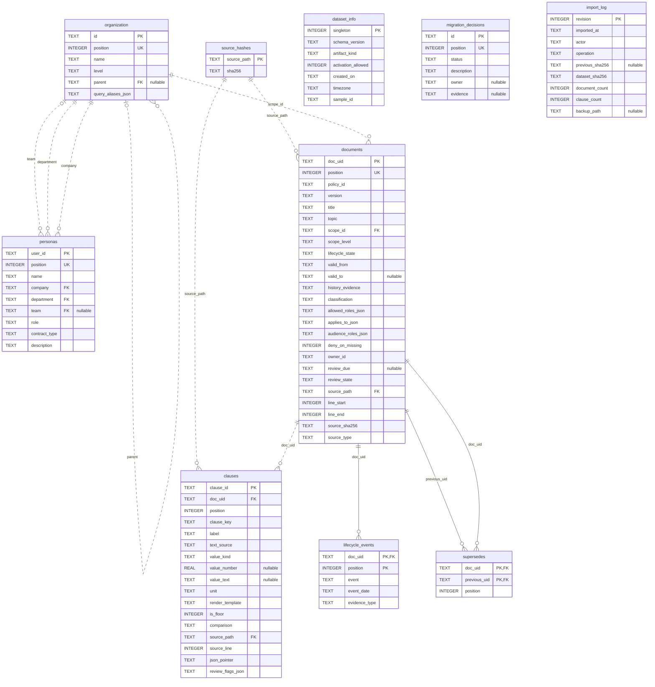

# ERD dữ liệu Appota — SQLite v1

Sơ đồ được đối chiếu trực tiếp với `data/appota.db` qua PRAGMA table_info / foreign_key_list / index_list. Đây là ERD vật lý: chỉ vẽ FOREIGN KEY có trong SQL. Nguồn schema: `database/schema.sql`. Số dòng là snapshot lúc tạo tài liệu ngày 2026-10-14.

## Sơ đồ đầy đủ

## Cách đọc

- **PK**: khóa chính; nhiều cột PK cùng bảng tạo khóa ghép.
- **FK**: khóa ngoại; nhãn cạnh là tên cột FK bên bảng con.
- **UK**: UNIQUE một cột. UNIQUE ghép được liệt kê riêng phía dưới; không đánh UK riêng cho từng thành phần.
- **nullable**: cột cho phép NULL. `||` ở phía bảng cha nghĩa là mỗi bản ghi con phải tham chiếu đúng một bản ghi cha; `o|` nghĩa là có thể không tham chiếu. `o{` ở phía con nghĩa là một bản ghi cha có thể có 0 hoặc nhiều bản ghi con.
- Cạnh nét đứt thể hiện quan hệ không định danh; cạnh liền thể hiện FK tham gia vào PK của bảng con.

SQL cho phép một document có 0 clause/event; validator runtime yêu cầu ít nhất một clause và event hợp lệ. ERD vẽ cardinality của SQL, không tự thêm ràng buộc nghiệp vụ.

## Khóa ghép và UNIQUE

| Bảng | Khóa chính | UNIQUE bổ sung |
|---|---|---|
| `organization` | `(id)` | `(position)` |
| `personas` | `(user_id)` | `(position)` |
| `source_hashes` | `(source_path)` | — |
| `documents` | `(doc_uid)` | `(policy_id, version)`; `(position)` |
| `clauses` | `(clause_id)` | `(doc_uid, position)`; `(doc_uid, clause_key)` |
| `lifecycle_events` | `(doc_uid, position)` | — |
| `supersedes` | `(doc_uid, previous_uid)` | `(doc_uid, position)` |
| `dataset_info` | `(singleton)` | — |
| `migration_decisions` | `(id)` | `(position)` |
| `import_log` | `(revision)` | — |

## Phạm vi từng bảng

| Bảng | Số dòng | Vai trò |
|---|---:|---|
| `organization` | 8 | Cây Group → Company → Department → Team; parent tự tham chiếu. |
| `personas` | 4 | Identity mock; company/department bắt buộc, team có thể NULL. |
| `source_hashes` | 3 | Nguồn và hash khai báo; document/clause tham chiếu bằng source_path. |
| `documents` | 8 | Mỗi dòng là một phiên bản policy; scope, hiệu lực, ACL và provenance. |
| `clauses` | 16 | Điều khoản có typed value, unit, floor và nguồn. |
| `lifecycle_events` | 9 | Chuỗi sự kiện phê duyệt/thay thế/thu hồi theo document. |
| `supersedes` | 1 | Bảng liên kết document mới với document cũ; cả hai FK cùng trỏ documents. |
| `dataset_info` | 1 | Metadata chung của bộ dữ liệu; singleton = 1. |
| `migration_decisions` | 6 | Các quyết định migration cần owner xác nhận. |
| `import_log` | 1 | Lịch sử import, hash trước/sau và đường dẫn backup. |

## Các giới hạn của ERD hiện tại

`dataset_info`, `migration_decisions`, `import_log` không có FK tới bảng khác. `import_log.dataset_sha256` là hash của toàn snapshot; không phải khóa ngoại. `documents.owner_id`, `migration_decisions.owner`, `import_log.actor` là text, chưa tham chiếu bảng users/owners. Các mảng role/alias/review flag vẫn là cột JSON, chưa có bảng roles hoặc bảng nối role riêng.

`policy_inventory` là VIEW đọc từ documents, organization và clauses; không phải entity lưu dữ liệu riêng. Không đưa bảng nội bộ SQLite `sqlite_sequence` vào ERD.

Ràng buộc chính: doc_uid = policy_id@version; clause_id = doc_uid#clause_key; valid_to exclusive và lớn hơn valid_from; parent không tự trỏ chính nó. Validator nghiệp vụ kiểm tra thêm chuỗi tổ chức, lifecycle, source hash, unit và floor. Chưa có bảng lưu lịch sử từng câu hỏi/answer/graph; graph được tạo theo snapshot và quyền của request.
