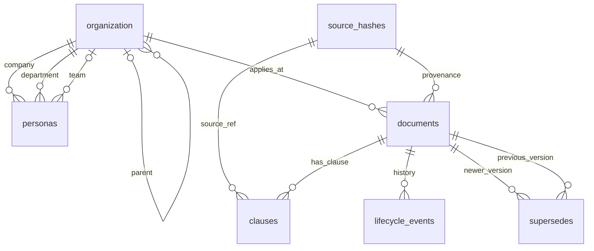

# Quản lý dữ liệu CSV và SQLite

Ứng dụng đọc dữ liệu từ **`data/appota.db`**. Database đã được khởi tạo từ fixture mock `data/knowledge.json`; JSON được giữ làm seed và fixture test. Sửa JSON không cập nhật database đang chạy. Có 9 bảng dữ liệu và bảng `import_log`, schema SQL ở `database/schema.sql`, truy vấn quản trị mẫu ở `database/queries.sql`.

Nhấp đúp **`manage_database.bat`** để xem trạng thái, kiểm tra CSV, import, export hoặc backup. Nhấp đúp `run_app.bat` để chạy ứng dụng; nếu chưa có database, launcher khởi tạo từ seed. Một database có sẵn không bị reset bởi lệnh `init`.

## Thử chỉnh dữ liệu

1. Mở `data/csv/clauses.csv`. Dòng `POL-A-LV@v2.0#entitlement` có `value_number = 14`, `unit = annual_paid_days`.
2. Đổi `value_number` thành **15**, lưu CSV UTF-8. Đây là thao tác thử trên dữ liệu mock. Cột `text_source` giữ nội dung nguồn; câu trả lời số được render từ giá trị typed. Khi thay đổi chính sách thực tế, cần cập nhật nội dung, governance và chứng cứ nguồn tương ứng.
3. Mở `manage_database.bat`, chọn **2** để kiểm tra toàn bộ bộ CSV. Chọn **3** để import; công cụ tạo backup và ghi revision trước khi báo thành công.
4. Mở hoặc tải lại ứng dụng, chọn Lan và ngày từ `2026-03-01`, hỏi “Tôi được nghỉ phép bao nhiêu ngày?”. Câu trả lời là 15 ngày; claim và graph dùng snapshot mới.
5. Để hoàn tác phép thử, đổi CSV lại thành 14, kiểm tra và import lại. Có thể xem bản database trước mỗi import trong `data/backups/`.

Sửa CSV chỉ có hiệu lực sau import. Export ở menu **4** ghi dữ liệu DB vào `data/exports/latest/`; không ghi vào bộ CSV đang chỉnh ở `data/csv/`. Nếu muốn nạp bản export đó, dùng `import-csv --dir data/exports/latest`.

## Các file CSV

| File | Số dòng seed | Nội dung quản lý |
|---|---:|---|
| `dataset_info.csv` | 1 | Phiên bản metadata, timezone, sample ID |
| `source_hashes.csv` | 3 | Nguồn và SHA-256 khai báo |
| `migration_decisions.csv` | 6 | Quyết định còn chờ content owner |
| `organization.csv` | 8 | Cây tổ chức và alias truy vấn |
| `personas.csv` | 4 | Profile identity mock, role, contract, scope |
| `documents.csv` | 8 | Policy/version, hiệu lực, ACL, owner, provenance |
| `clauses.csv` | 16 | Điều khoản, typed value, unit, sàn và nguồn |
| `lifecycle_events.csv` | 9 | Chuỗi drafted/approved/superseded/revoked |
| `supersedes.csv` | 1 | Liên kết phiên bản thay thế |

CSV có UTF-8 BOM để đọc tiếng Việt trên Windows, dấu phẩy phân cột, header cố định. Mở qua **Data → From Text/CSV** của Excel, chọn UTF-8 và kiểu Text cho ID/ngày/JSON để giữ nguyên format. Các số dùng dấu chấm thập phân, boolean dùng `0`/`1`, ngày dùng `YYYY-MM-DD`. Không đổi tên hoặc thứ tự cột.

`\N` là NULL. Ô rỗng là chuỗi rỗng, không phải NULL và không phải số 0. Giá trị text bắt đầu bằng dấu `\` được escape thêm một dấu `\` khi export: text literal `\N` được ghi thành `\\N`. Các cột `_json` chứa JSON array thực, ví dụ `["Executive","Board"]` hoặc `[]`; CSV writer tự quote dấu nháy bên trong. Không nhập `Executive;Board` thay cho JSON.

Giữ `doc_uid = policy_id@version`, `clause_id = doc_uid#clause_key`. `position` giữ thứ tự bản ghi/sự kiện. Unlimited dùng `value_kind=unlimited`, cả `value_number` và `value_text` là `\N`; không dùng sentinel 99. Enum dùng `value_text`; number dùng `value_number`.

Import là **thay toàn bộ 9 bảng trong cùng transaction**. Phải gửi đủ 9 CSV và mọi bản ghi cần giữ; không phải import từng dòng hoặc upsert. Các liên kết supersedes, event, clause được kiểm tra cùng bộ dữ liệu. Với seed này, ngày 2026-02-28 vẫn là conflict do khoảng trống hiệu lực đã biết; không tự sửa nó trong bước chuyển database.

## Lệnh PowerShell

Chạy tại thư mục dự án; mọi lệnh dùng `.venv` hiện có, không thêm dependency.

```powershell
.\.venv\Scripts\python.exe -B manage_database.py init
.\.venv\Scripts\python.exe -B manage_database.py status
.\.venv\Scripts\python.exe -B manage_database.py check-csv --dir data\csv
.\.venv\Scripts\python.exe -B manage_database.py import-csv --dir data\csv --actor local-owner
.\.venv\Scripts\python.exe -B manage_database.py validate
.\.venv\Scripts\python.exe -B manage_database.py export-csv --dir data\exports\my-review
.\.venv\Scripts\python.exe -B manage_database.py backup
```

Đổi database bằng tham số global đặt trước subcommand, ví dụ `manage_database.py --db data\experiment.db init`. Export từ CLI từ chối ghi đè file có sẵn trừ khi truyền `--overwrite`. Lệnh quản trị trả exit 0 khi thành công, 2 khi lỗi.

Test database đang chỉnh:

```powershell
.\.venv\Scripts\python.exe -B run_tests.py --db data\appota.db --cases tests\test_cases.json
.\.venv\Scripts\python.exe -B run_tests.py --db data\appota.db --cases tests\private_test_cases.json
.\.venv\Scripts\python.exe -B -m unittest discover -s tests -p test_database.py -v
```

Scenario mặc định vẫn dùng JSON seed cố định, còn `run_private_tests.bat` dùng database thật. Vì kỳ vọng scenario là fixture 14 ngày, đổi dữ liệu mock thành 15 sẽ làm case tương ứng FAIL; đó là khác biệt dữ liệu cần review. PT32 đã được sửa bằng taxonomy dùng chung với TypeScript; truy vấn chỉ có năm được yêu cầu bổ sung ngày cụ thể.

## Quan hệ bảng

ERD vật lý đầy đủ, thuộc tính, khóa ghép và cardinality: [data_erd.md](data_erd.md). Sơ đồ dưới tóm tắt các FK thực trong SQL; các bảng quản trị không có FK được mô tả riêng trong ERD đầy đủ.



`dataset_info`, `migration_decisions` và `import_log` không có FK tới bảng khác. Log lưu hash snapshot; validator runtime yêu cầu document có clause/event hợp lệ dù SQL không bắt buộc phải có bản ghi con. Các bảng quản trị không được hiển thị toàn bộ trong UI nhân viên. App vẫn lọc ACL/audience/scope và tạo graph theo persona từ một snapshot.

## SQL, validation và phạm vi

SQLite schema v1 dùng PRIMARY KEY, FOREIGN KEY, UNIQUE, CHECK, bảng STRICT, index và view `policy_inventory`. Bộ dữ liệu tái dựng được kiểm tra tiếp bằng JSON Schema và validator nghiệp vụ hiện có: cây tổ chức, approval/revoke, provenance, typed units và floors. Foreign keys được bật trên từng connection; backup dùng API SQLite để sao chép database nhất quán, theo [tài liệu foreign keys](https://www.sqlite.org/foreignkeys.html) và [backup API](https://www.sqlite.org/backup.html).

Mỗi import hợp lệ tạo backup trước khi thay dữ liệu, rồi ghi `import_log` với timestamp UTC, actor do người chạy khai báo, hash trước/sau và số document/clause. Actor chưa gắn với đăng nhập. Backup thành công nhưng import lỗi có thể để lại file backup; dữ liệu và revision không bị commit một phần.

Có thể mở `.db` bằng SQLite client để chạy SQL. SQL viết trực tiếp không tạo import log hoặc backup tự động; chạy `validate` sau đó. App tái kiểm tra dữ liệu và fingerprint nội dung khi rerun, kể cả SQL không tăng revision. Database sai hoặc không đọc được làm ứng dụng dừng tải chính sách; không tự fallback sang JSON. App chưa có polling tự động: sau import cần tải lại hoặc tương tác để rerun.

SQLite hiện phục vụ bản local một người quản trị. Đây chưa phải dịch vụ database nhiều người dùng, chưa có xác thực quản trị hoặc mã hóa database. File DB, backup và các CSV đầy đủ là dữ liệu quản trị; ACL của app không hạn chế người có quyền đọc trực tiếp các file đó. Database/backup không được commit vào Git; tái tạo bằng `init`. Khi chuyển sang server database, cần migration riêng, không dùng nguyên SQL SQLite cho PostgreSQL/MySQL.
