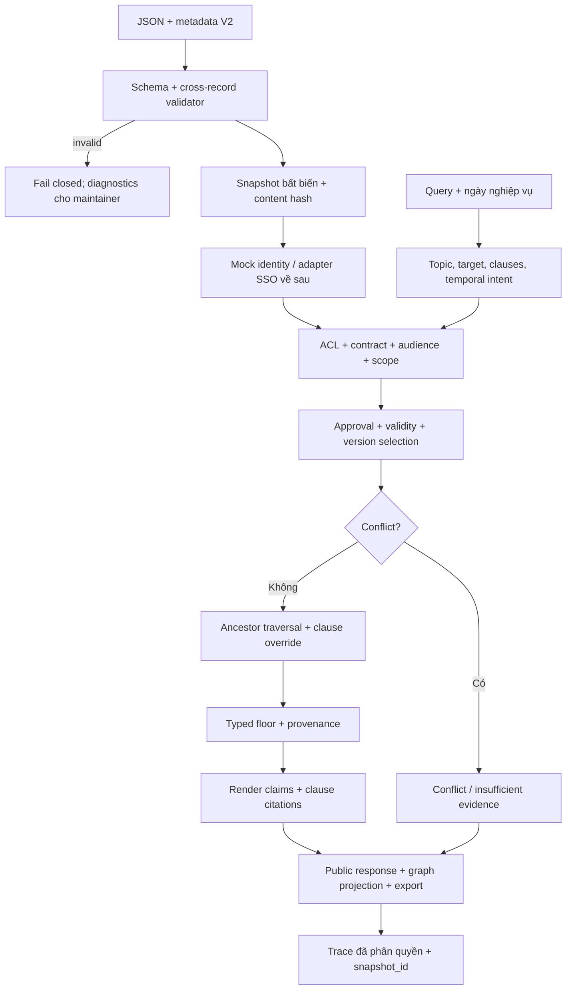
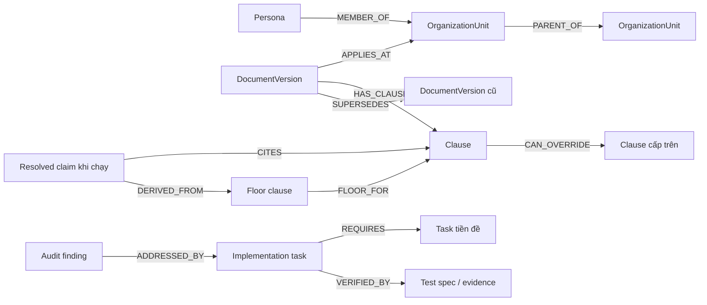

# Implementation plan V2 — Appota Internal Knowledge

> Cập nhật triển khai 13/10/2026: engine/UI V2 đã được xây dựng và kiểm thử. Phần phạm vi “chỉ lập kế hoạch” dưới đây là snapshot lúc lập plan. Trạng thái thực tế xem `data/improvement_tracking.json`, `docs/evidence/` và `../AUDIT_REPORT.md`; các quyết định content owner vẫn được giữ tách biệt. Baseline 43/100 bên dưới là số liệu lịch sử; báo cáo hiện tại ghi 83/100.

Ngày lập: 13/10/2026. Phạm vi được chọn: **kế hoạch triển khai, metadata mẫu và graph theo dõi**. Chưa sửa engine/UI, chưa chạy lại test ứng dụng. Baseline lịch sử lúc lập kế hoạch là **43/100**; mục tiêu nghiệm thu là **≥90/100 sau triển khai và re-audit**.

## 1. Đầu ra của bản kế hoạch

| Artifact | Dùng để làm gì |
|---|---|
| `docs/implementation_plan_v2.md` | Kiến trúc, thứ tự triển khai, API, metadata, test, điều kiện nghiệm thu. |
| `data/metadata_v2.sample.json` | Mẫu V2 cho đủ 8 document, 16 clause, 8 unit, 4 persona; có provenance về dữ liệu gốc. Tách riêng, không thay `data/documents.json`. |
| `schemas/knowledge_metadata_v2.schema.json` | JSON Schema kiểm tra cấu trúc mẫu; kiểm tra quan hệ/thời gian phải bổ sung trong validator khi triển khai. |
| `data/improvement_tracking.json` | 19 task tương ứng 19 findings, điểm thu hồi, phụ thuộc, file dự kiến, test nghiệm thu, bằng chứng và owner chưa phân công. |
| `data/knowledge_graph.sample.json` | Nodes/edges có type và metadata_ref; là graph thiết kế từ fixture, không phải output của engine V2. |
| `docs/tracking_graph.html` | Mở trực tiếp bằng trình duyệt để xem hai graph, chọn node xem metadata, cập nhật trạng thái task, export/import tiến độ. Không cần server/CDN. |
| `docs/tracking_graph_preview.png` | Ảnh preview graph tiến độ ở chế độ toàn cảnh; tương tác và trạng thái tiếp tục thực hiện trong HTML. |
| `docs/artifact_validation_v2.md` | Kết quả kiểm tra metadata/schema, graph, checksum và tương tác trình duyệt; không phải kết quả test engine V2. |

Graph là **công cụ thiết kế cho người làm dự án**, có nhúng toàn bộ dữ liệu giả lập gồm metadata Confidential. Bộ lọc persona trong graph chỉ mô phỏng applicability; file này không phải UI phân quyền và không được đưa nguyên sang tài khoản nhân viên khi dùng dữ liệu thật. Progress lưu trong trình duyệt, chưa có backend nhiều người dùng; export JSON để chia sẻ/check-in. Các file JSON là nguồn dữ liệu của bản bàn giao; HTML chứa snapshot để mở offline, và có nút nạp JSON mới cho từng loại dữ liệu.

## 2. Mốc ≥90 và cách tính có thể kiểm tra

Không tăng điểm chỉ vì đã tạo plan hoặc có graph. Tổng điểm có thể lấy lại là 57, nhưng chỉ công nhận từng finding sau khi có thay đổi, regression test và review bằng chứng. Graph luôn giữ **baseline 43**; chỉ hiển thị **ước tính theo task được đánh dấu verified**, chưa phải điểm re-audit.

| Hạng mục | Baseline | Mục tiêu tối thiểu | Điểm cần lấy lại | Finding liên quan |
|---|---:|---:|---:|---|
| Logic & phương pháp | 8/25 | 23/25 | 15 | F02, F03, F04, F05, F06 |
| Dữ liệu & leakage | 2/15 | 14/15 | 12 | F01, F07, F08, F09 |
| Code & kiến trúc | 6/15 | 13/15 | 7 | F10, F11, F12, F17 |
| Reproducibility | 8/12 | 11/12 | 3 | F16 |
| Notebook & mạch trình bày | 10/10 | 10/10 | 0 | Không có notebook; giữ cách tính rubric audit gốc. |
| Hiệu năng | 6/8 | 7/8 | 1 | F18 |
| Kiểm thử | 0/8 | 7/8 | 7 | F13, F14, F15 |
| Naming/readability/tài liệu trong code | 3/7 | 5/7 | 2 | F19 |
| **Tổng** | **43/100** | **90/100** | **47** | Mục tiêu tối thiểu; ưu tiên đóng đủ 19 findings để có dư địa. |

Các mức mục tiêu là phân bổ mong muốn, không có quy tắc tự động hoàn điểm một phần. Task vẫn ghi toàn bộ điểm trừ gốc; re-audit quyết định điểm thực tế. Bất kỳ CRITICAL chưa đóng thì không đạt release; mọi HIGH phải đóng, kể cả khi tổng ước tính đã ≥90. Thay đổi mới gây lỗi mới vẫn bị trừ điểm.

### Release gates

1. **G1 — Không lộ quyền:** answer, citation, graph, export, debug, cache và log người dùng đều qua cùng policy decision; không hiện tên/ID/count tài liệu ngoài quyền. Không coi việc che node bằng CSS là ACL.
2. **G2 — Chính sách đúng:** value, unit, text, nguồn và sàn nhất quán; lịch sử/version không phụ thuộc thứ tự file; conflict trả trạng thái có kiểm soát.
3. **G3 — Query có phạm vi:** câu rỗng/ngoài topic/thiếu căn cứ có status riêng; câu hỏi phê duyệt có “sếp” không bị chặn nhầm; không tự cấp quyền xin ngoại lệ.
4. **G4 — Metadata hợp lệ:** schema, foreign key, graph cycle, khoảng hiệu lực, approval, audience và ACL đều được validate trước tạo snapshot.
5. **G5 — Test thật:** suite dùng oracle, không hard-code kết quả, fail trả exit code khác 0; có cả test UI/export và mutation negative control.
6. **G6 — Tái dựng:** môi trường khóa phiên bản; clean environment chạy được; cùng snapshot/date/query cho cùng response và graph.
7. **G7 — Review:** không còn CRITICAL/HIGH mở; các task verified có owner, reviewer và evidence; audit mới có điểm ≥90. Audit cũ được giữ nguyên làm baseline.

## 3. Kiến trúc triển khai dự kiến

Giữ Python + Streamlit và rule engine local cho phạm vi leave-policy hiện tại. Chưa cần Neo4j/vector DB/LLM để giải 19 finding. Knowledge graph có typed node/edge, adjacency index và validator; có thể export sang graph database sau nếu quy mô/query thực tế đòi hỏi.

**Ranh giới quyền:** UI không được lấy `assistant.documents` rồi tự lọc. API projection chỉ nhận request identity đã resolve và trả dữ liệu được phép. Kết quả deny không chứa ID hoặc số lượng rejected document. Maintainer diagnostics có endpoint/view riêng, quyền riêng và kiểm tra lại tại thời điểm truy cập. Identity chọn persona chỉ phục vụ demo; triển khai thật cần identity từ session SSO đã xác thực, không lấy user_id tùy ý từ browser.

### Module/API sẽ thêm hoặc thay đổi khi được triển khai

| Module dự kiến | Trách nhiệm | Hợp đồng chính |
|---|---|---|
| `engine/models.py` | Typed request, policy version, clause, citation, trace | Enum access/status/result; không dùng số 99 đại diện unlimited. |
| `engine/metadata.py` | Load + schema + cross-record validation | `load_snapshot(data_dir) -> KnowledgeSnapshot`; lỗi có code/path, không trả kho một phần không rõ ràng. |
| `engine/snapshot.py` | Hash nội dung, parse date một lần, graph index | Snapshot bất biến; UI/engine dùng cùng `snapshot_id`; reload nguyên tử. |
| `engine/identity.py` | Profile từ cùng snapshot, adapter identity | Không cho caller sửa profile dùng chung; xác thực chain với org graph. |
| `engine/filter.py` | Một nơi quyết định visibility/applicability | `evaluate_access(profile, version, date) -> decision`; ACL thiếu/sai = deny. Audience khác allowed_roles. |
| `engine/timeline.py` | Approval, revocation, validity, version overlap | `[valid_from, valid_to)`; chọn as-of date; ambiguous same policy/scope/audience = conflict. |
| `engine/hierarchy.py` | Traverse ancestor + resolve từng clause | Parent chain từ organization; reject cycle/level sai; explicit override theo scope depth. |
| `engine/semantic_matcher.py` | Routing giới hạn theo topic/target/slot | `Intent(topic, clause_keys, target, temporal_date, scenario_flags)`; không tự nhận mọi câu là leave. |
| `engine/generator.py` | Render từ resolved claim | Không đọc source store; citation key `(doc_uid, clause_id)`; sàn có nguồn thực sự dùng. |
| `engine/knowledge_graph.py` | Typed graph + user projection | `project_graph(profile, date, trace=None)`; tính projection ở backend, lọc dangling edge. |
| `engine/trace.py` | Trace có trạng thái và snapshot | Không lưu raw query/PII mặc định; public trace và restricted maintainer trace tách quyền. |
| `engine/core.py` | Điều phối ngắn theo các API trên | `answer_query(user_id, query, query_date=None)`; date mặc định từ clock Asia/Ho_Chi_Minh. |
| `app.py` | Form, answer, user graph, node detail | Cùng snapshot cho sidebar và answer; reset response khi identity/date/snapshot đổi. |
| `tests/` + `run_tests.py` | Oracle, regression, negative controls | Runner trả exit code; test ID và evidence vào tracking artifact. |

`AnswerResult` dự kiến gồm `status`, `answer`, `claims`, `citations`, `scope_path`, `snapshot_id`, `trace_id`; status thuộc `answered`, `refused`, `out_of_scope`, `needs_clarification`, `insufficient_evidence`, `conflict`, `invalid_request`, `system_error`. Không dùng một boolean success để gộp mọi tình huống. Chi tiết lỗi metadata chỉ dành cho maintainer; người dùng nhận message phù hợp, không nhận stack trace hoặc document ngoài quyền.

## 4. Metadata V2 và các quyết định migration

Mẫu là **design fixture**, `activation_allowed=false`. Không thay đổi dữ liệu app hiện tại. Approval events và các điều chỉnh đề xuất đều được gắn `synthetic_proposal`, không được hiểu là lịch sử phê duyệt thật.

| Nhóm | Field chính | Quy tắc |
|---|---|---|
| Identity của document | `doc_uid`, `policy_id`, `version`, `topic` | `doc_uid = policy_id@version`; unique; version là identifier, không sort lexical để chọn chính sách. |
| Scope | `scope.unit_id`, `scope.level` | Foreign key hợp lệ; level phải khớp unit; chain từ parent graph, không ghép bằng trust profile. |
| Lifecycle | `state`, `valid_from`, `valid_to`, `events` | State hiện tại khác trạng thái as-of; interval nửa mở; event phê duyệt/thu hồi có provenance. Draft không được dùng làm answer. |
| Access | `classification`, `allowed_roles`, `applies_to`, `audience_roles`, `deny_on_missing` | Classification closed enum; Confidential phải có allowed_roles; audience quy định policy áp dụng cho ai, ACL quy định ai được đọc. |
| Governance | `owner_id`, `review_due`, `review_state` | Owner đề xuất giữ từ seed; ngày review còn null phải được owner chốt; không bịa reviewer. |
| Clause | `clause_id`, `key`, `typed_value`, `render_template`, `is_floor`, `comparison` | Numeric có unit; unlimited có type riêng và value null; floor chỉ so các giá trị tương thích đơn vị/ý nghĩa. |
| Provenance | `source_path`, `line_start`, `line_end`, `sha256`, `source_type` | Nhận diện đúng snapshot nguồn; citation tham chiếu clause; không lấy hash làm bằng chứng approval. |
| Runtime trace dự kiến | `query_id`, `snapshot_id`, `selected_clause_ids`, `overrides`, `floor_decisions` | Không lưu thông tin ngoài quyền trong public trace; source/owner diagnostics có phân quyền riêng. |

### Các quyết định chưa được phép coi là đã chốt

- **M01 — Khoảng hiệu lực v1 A:** seed có effective_to 2026-02-28, trong khi engine coi ngày kết thúc exclusive và v2 bắt đầu 2026-03-01 (`../engine/filter.py:29`, `../data/documents.json:36`, `../data/documents.json:60`). Mẫu đề xuất end-exclusive 2026-03-01 để liền mạch; owner phải xác nhận có hiệu lực hết 28/02 hay không. Không tự sửa seed.
- **M02 — Ngày báo trước Team:** text Team nói “10 ngày”, không chỉ rõ working/calendar (`../data/documents.json:152`). Mẫu giữ unit `unspecified_days`, không tự đổi thành business_days. Cần owner xác nhận trước khi chạy so sánh/ràng buộc thời gian.
- **M03 — Unlimited:** seed dùng value 99 nhưng text “không giới hạn” (`../data/documents.json:198`). Mẫu dùng `kind=unlimited, value=null`; cần xác nhận là unlimited thật hay giới hạn 99.
- **M04 — Approval history:** seed chỉ có status và ngày hiệu lực, không có bằng chứng approval events. Events trong mẫu chỉ là synthetic fixture để thiết kế/test, không đủ làm lịch sử thật khi đưa dữ liệu thật vào.
- **M05 — Draft HR:** seed Internal nhưng có allowed_roles HR_Admin (`../data/documents.json:171`). Cần định nghĩa rõ quyền preview Draft của content owner; draft preview tách khỏi answer endpoint, không suy từ Internal rằng mọi nhân viên được xem.
- **M06 — Quyền Executive:** phải xác nhận điều khoản lãnh đạo bổ sung hay thay thế policy chung và audience áp dụng; ACL đọc được không tự đồng nghĩa được hưởng quyền lợi đó.

### Validation ngoài JSON Schema

JSON Schema chỉ xác nhận shape/enum/type/date format. Triển khai phải thêm: unique ID; foreign key; parent cycle; level/parent hợp lệ; persona chain; event order; end > start; approved before effective; scope/audience overlap; clause source tồn tại; unit tương thích; text/value rendering nhất quán; root thực tế; confidential roles không rỗng; trace không có cạnh dangling. Unknown metadata phải bị reject hoặc đi vào trường extension đã đặt tên, không mặc định cho qua.

## 5. Knowledge graph và graph tracking

### Ontology

`CAN_OVERRIDE` và `FLOOR_FOR` là quan hệ ứng viên, không khẳng định một override đã xảy ra. Phải thỏa quyền, audience, ngày, phiên bản và unit trước khi resolve. `CITES/DERIVED_FROM` chỉ xuất hiện khi có runtime trace; bản mẫu chưa tạo trace giả. `VERIFIED_BY` trong tracker là test specification cho tới khi có evidence thực thi. Graph tri thức mẫu chứa 36 nodes (8 unit, 4 persona, 8 version, 16 clause); graph tiến độ có 19 task và các cạnh dependency tương ứng.

### Cách dùng `tracking_graph.html`

1. Mở file bằng trình duyệt, chọn **Tiến độ sửa audit** hoặc **Sơ đồ tri thức**.
2. Chọn node trên graph, bằng phím Tab/Enter, hoặc qua danh sách. Panel chi tiết hiển thị metadata, quan hệ, source, task phụ thuộc và test spec.
3. Trong graph tiến độ, cập nhật owner, status, evidence và reviewer. `verified` yêu cầu evidence, reviewer và các dependency đã verified; đây là xác nhận thủ công, không tự chạy test.
4. **Lưu trạng thái** lưu vào localStorage nếu trình duyệt hỗ trợ. **Xuất tiến độ JSON** tạo bản chia sẻ; **Nạp tiến độ JSON** kiểm tra task IDs và dependencies trước khi nhận.
5. **Nạp metadata/graph JSON** dùng file thiết kế mới nếu chỉnh JSON nguồn; HTML không tự đọc file local mỗi lần mở. Mỗi lần nạp sample kiểm tra các reference và dựng lại graph.
6. Bộ lọc persona/ngày chỉ hỗ trợ xem bản thiết kế; tất cả dữ liệu mock vẫn nằm trong HTML. Khi triển khai UI thật, backend chỉ trả projection được phép và không gửi hidden nodes xuống client.

## 6. Thứ tự triển khai và effort

Đơn vị effort là **ngày công kỹ thuật có test/review**, chưa tính thời gian chờ content owner hoặc tích hợp SSO thật. Dự kiến tổng 13–20 ngày công cho một người, không phải deadline cam kết. Không chạy song song bằng sub-agent trong bản lập kế hoạch này.

| Milestone | Task | Kết quả bắt buộc | Effort |
|---|---|---|---|
| P0 — Nền kiểm chứng | T13, T14, T16 | Oracle không hard-code, fail exit, environment tái dựng; test F01/F02 ban đầu phải phát hiện regression. | 2–3 ngày |
| P1 — Metadata và snapshot | T10, T05, T06, T07, T08, T09, T17 | Schema/cross-validation, clock, history/version, ACL, org traversal, snapshot nhất quán. | 4–6 ngày |
| P2 — Đóng CRITICAL | T01 | UI/debug/export/graph không lộ document ngoài quyền; owner duyệt migration M01–M06 có ảnh hưởng. | 1–2 ngày |
| P3 — Đúng câu hỏi và nguồn | T04, T03, T02, T11, T12 | Query routing, fallback căn cứ, floor đúng cả text/value, citation theo clause, code gọn. | 4–6 ngày |
| P4 — Nghiệm thu | T15, T18, T19 | Regression/negative controls, benchmark có số liệu, docs đúng code, re-audit ≥90. | 2–3 ngày |

Critical path dự kiến: T10 → T08/T09/T17 → T01 → T15 → re-audit. Nhánh correctness: T05 → T06 → T07 → T02 → T11 → T12 → T15. Dependency đầy đủ nằm trong `data/improvement_tracking.json`; không bắt đầu rollout chỉ vì task hiện “done” mà thiếu evidence.

### Mỗi task phải có definition of done

- Implementation đúng hợp đồng, file/module thay đổi được review.
- Test spec gắn finding chuyển thành test thực thi; chạy được bằng lệnh tái dựng, có timestamp, commit/content hash, environment, exit code và result.
- Negative control/mutation tương ứng chứng minh test thất bại khi đưa lỗi trở lại; không chỉ assert lặp đúng implementation.
- Evidence lưu đường dẫn artifact hoặc CI run, reviewer và owner thực; tracker chuyển `planned → in_progress → review → verified`, hoặc `blocked` với lý do.
- Đánh dấu verified không tự sửa `AUDIT_REPORT.md`; tạo audit sau triển khai riêng và đối chiếu F01–F19.

## 7. Test nghiệm thu cụ thể

Các ID sau là **test sẽ triển khai**, chưa phải test đã chạy. Mỗi task trong JSON có tập test tương ứng; expected values độc lập với renderer, kiểm cả structured result và text/projection.

| Nhóm / Finding | Input và expectation |
|---|---|
| ACL/UI — F01/F08 | Lan không nhận EXEC ID/title/version/count ở answer, citations, graph, export, debug; Nam không nhận policy Official; Confidential thiếu/sai classification/roles phải reject/fail closed. Injection đổi vai trò trong query không đổi identity. |
| Floor — F02 | Unit policy 10 dưới floor 12: text và typed value là 12, source là floor, trace chứa override ở quyền phù hợp; policy 14 giữ 14; unit không tương thích trả lỗi/needs_review, không so số mù quáng. |
| Query — F03/F04 | Query rỗng → needs_clarification; hỏi lương → out_of_scope; “Sếp nào duyệt đơn nghỉ phép?” → approver hợp lệ; không người trực thay → nêu điều kiện và thiếu căn cứ ngoại lệ, không tự duyệt/escalate như quy định đã có. |
| Clock/history — F05/F06 | Clock giả tại 2026-10-13 và 2027-01-01; query_date explicit nhất quán; trước/on/after valid_from và valid_to; Jan 2026 chọn A v1 notice 3; Mar 2026 chọn A v2 entitlement 14; Draft/Revoked không trở thành Approved chỉ vì thời gian đã tới. |
| Version — F07 | Hai version overlap cùng policy/scope/audience → conflict; đảo thứ tự JSON không đổi kết quả; policy chung và Executive được giải theo audience khác nhau, không chọn theo lexicographic version. |
| Org/schema — F09/F10 | Team B trong profile company A, unknown parent, cycle, wrong level, bad date, missing field, value type sai → reject có diagnostic cho maintainer; API public không lộ document IDs lỗi ngoài quyền. |
| Citation — F11 | Lan có mapping đủ entitlement/notice/approver; Hùng đủ 5 clause; một document nhiều clause vẫn giữ đủ claim→source; floor có provenance; graph không có edge dangling. |
| Code/cache — F12/F17 | Snapshot đổi nội dung cùng path làm invalidation; sidebar/answer/graph cùng snapshot_id; đổi persona xóa response cũ; không trả reference mutable sửa được profile trong snapshot. |
| Oracle/exit — F13/F14 | Sửa expected notice_days làm test fail; xóa blackout/contingency hoặc thêm doc cấm làm test fail; TC07 quyết định từ response; một fail phải trả nonzero; known xfail không nuốt fail mới. |
| Coverage — F15 | Phủ cả 4 persona và unknown ID; API + Streamlit UI + export; các mutation bỏ role/scope/floor/clause citation đều bị suite bắt. Coverage phần trăm là chỉ báo phụ, không thay invariant. |
| Repro/perf/docs — F16/F18/F19 | Clean environment; same input/snapshot/date ổn định; parse query date một lần/request và doc date một lần/snapshot; benchmark p50/p95 có environment/dataset size; không còn tuyên bố vô điều kiện “100%/miễn nhiễm” thiếu test/phạm vi. |

## 8. Quy trình migration và rollout dự kiến

1. Giữ checksum dữ liệu gốc, audit baseline và fixture hiện tại. Mẫu V2 lưu riêng và schema-version riêng; không import sample làm dữ liệu đang hoạt động.
2. Owner trả lời M01–M06; ghi quyết định, approver và evidence trong migration record. Không có đáp án thì blocked, không điền mặc định cho metadata quyền/ngày.
3. Migration tạo dataset V2 mới; validate shape và cross-record rồi build snapshot/hash; invalid toàn bộ hoặc quarantine có danh sách maintainer, không silently drop.
4. Chạy engine mới ở fixture/shadow mode, so claim/citation/graph với expected đã duyệt, không lấy renderer cũ làm oracle duy nhất.
5. Khi release gates đều pass, chuyển snapshot reference nguyên tử. Rollback bằng snapshot/version đã xác nhận; thu hồi quyền phải invalidate ngay, không phục hồi snapshot chứa quyền đã bị thu hồi.
6. Re-audit tạo báo cáo mới; chỉ công nhận ≥90 khi có bằng chứng, kiểm cả lỗi mới và các đường graph/export vừa thêm.

## 9. Giới hạn hiện tại của bản bàn giao

Ứng dụng hiện tại vẫn ở baseline 43/100 vì chưa triển khai các task. HTML tracker không chạy test hay xác thực evidence, không tự đồng bộ nhiều thiết bị, không bảo vệ dữ liệu thật bằng persona filter. Metadata và graph mẫu thể hiện thiết kế cần triển khai, không chứng minh runtime engine đã có các chức năng đó. Bắt đầu triển khai từ P0/P1, đồng thời ưu tiên đóng F01 ngay khi policy/snapshot nền sẵn sàng.
